# 任务三 单机环境实现阶段技术文档

智慧图书馆数字资源平台的任务三已经完成独立 MongoDB 单机环境、基础数据初始化、六类检索、五项统计、索引优化实验以及三类角色权限控制。本阶段文档面向成员 B、C 的组内交接与后续总报告整合，重点说明技术路线、实现方法、真实结果和证据位置，不扩展任务四、GridFS、副本集或分片集群内容。

## 3.1 单机 MongoDB 环境部署

原 MongoDB 服务使用默认数据目录和端口。为满足任务书对独立单机环境的要求，并避免实验数据与原服务相互影响，任务三额外部署了 MongoDB 8.0.32 专用实例。该实例使用独立配置文件、独立日志目录和自定义数据目录，通过专用端口向 Windows 端工具提供服务。

| 配置项 | 实施值 | 作用 |
|---|---|---|
| 数据目录 | `/var/lib/smart_library_mongo` | 隔离任务三业务数据 |
| 服务端口 | `27018` | 与默认实例的 `27017` 区分 |
| 配置与日志 | 独立文件和目录 | 便于单独启动、排查和维护 |
| 客户端链路 | CentOS MongoDB → Windows Compass / PyMongo | 支持图形化检查与脚本执行 |

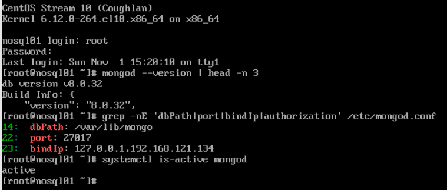

图 3-1 MongoDB 运行环境与默认数据目录

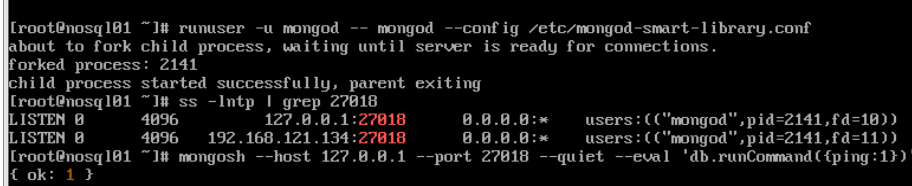

图 3-2 自定义数据目录实例启动与端口监听

Windows 端 MongoDB Compass 与 Python 均已连接至该专用实例。Compass 用于检查数据库、集合和文档数量，PyMongo 负责初始化、导入、查询、统计、索引和权限脚本的可复现执行。

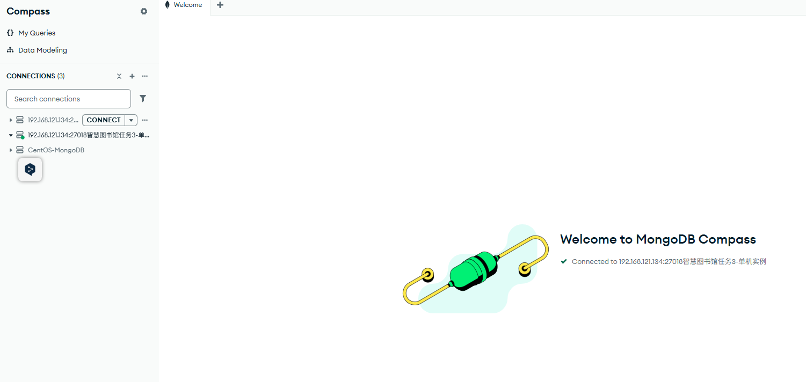

图 3-3 Compass 连接专用 MongoDB 实例

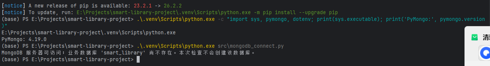

图 3-4 Python 连接专用 MongoDB 实例

## 3.2 数据库 集合与基础数据初始化

任务三使用数据库 `smart_library`。初始化脚本按需创建五个普通集合，不删除已存在集合，也不覆盖已有业务数据。按照任务二确定的模型，`borrow_logs` 保持普通集合，不改为时序集合。

| 集合 | 用途 | 阶段结果 |
|---|---|---|
| `books` | 图书基础信息 | 50 条 |
| `readers` | 读者基础信息 | 30 条 |
| `borrow_logs` | 借阅流水 | 3000 条 |
| `audit_logs` | 操作审计 | 已创建，供权限验证和后续应用使用 |
| `stat_result` | 持久化统计结果 | 分类统计 6 条 |

| 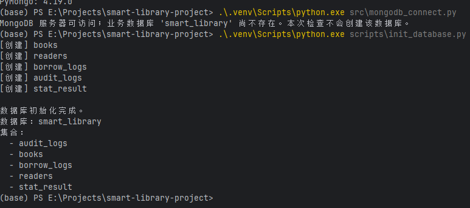 | 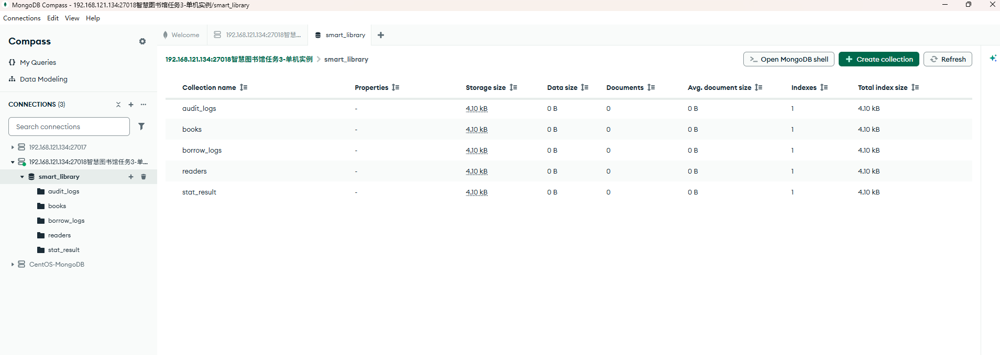 |
|:---:|:---:|
| (a) 数据库及五个集合初始化 | (b) Compass 集合结构验证 |

图 3-5 数据库与集合初始化验证

导入脚本读取三份 JSON 数组，在写入前对日期字段进行转换：`books.publish_date`、`readers.register_date`、`borrow_logs.borrow_date` 和 `borrow_logs.return_date` 由 ISO 8601 字符串转换为 Python `datetime`，最终写入 BSON Date。原始 ISBN、业务字段和合法缺失字段均按任务二数据规则保留。脚本在导入前检查目标集合是否为空，避免重复写入；导入后同时核对数量和日期字段类型。

| 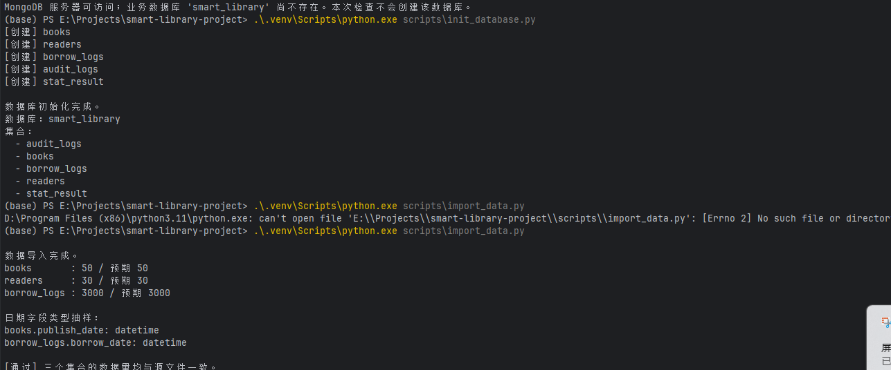 | 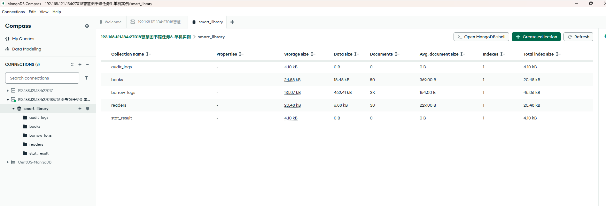 |
|:---:|:---:|
| (a) 导入脚本数量与日期类型核验 | (b) Compass 集合文档数量核验 |

图 3-6 基础数据导入与数量核验

## 3.3 检索功能实现

六类检索由 `scripts/task3_queries.py` 统一执行，真实 MongoDB 命令、返回数量和结果明细已保存在 `docs/任务3_检索执行记录.md`。实现根据业务条件分别使用组合条件、数组匹配、正则表达式、日期范围、字段存在性判断以及排序和限制。

| 编号 | 检索功能 | 关键操作 | 实际结果 |
|---:|---|---|---:|
| Q1 | 计算机类且价格 50—100 元 | `$gte`、`$lte`、`sort` | 8 条 |
| Q2 | 同时具有“编程”和“入门”标签 | `$all` | 1 条 |
| Q3 | 书名包含“Python” | `$regex`、`$options` | 2 条 |
| Q4 | 出版年份为 2021—2023 | BSON Date 左闭右开范围 | 5 条 |
| Q5 | 缺少 `tags` 字段 | `$exists: false` | 4 条 |
| Q6 | 评分降序 Top 10 | `sort`、字段投影、`limit` | 10 条 |

Q4 使用北京时间 2021 年 1 月 1 日至 2024 年 1 月 1 日的左闭右开区间，避免年末边界遗漏；Q6 在评分相同时按书名升序，以保证结果顺序稳定。

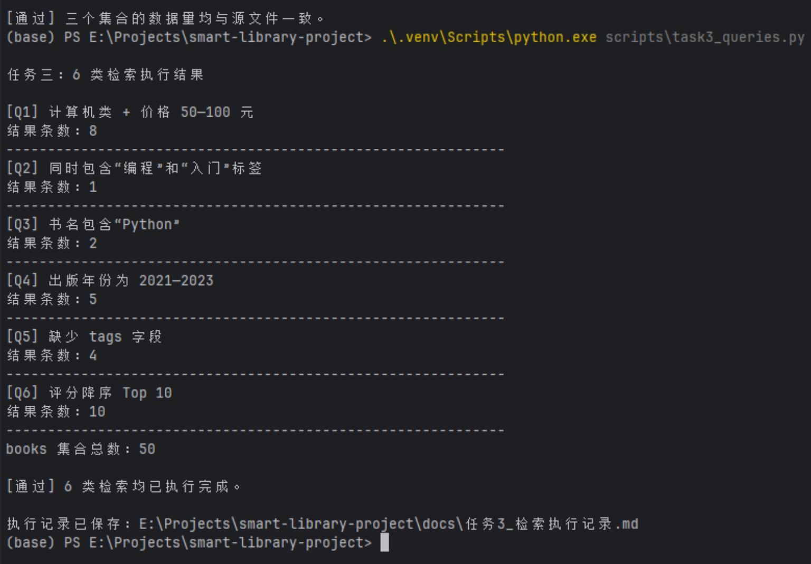

图 3-7 六类检索功能执行结果

## 3.4 统计分析实现

五项统计由 `scripts/task3_statistics.py` 完成，聚合管道和真实结果已保存在 `docs/任务3_统计执行记录.md`。统计过程围绕 `$group`、`$lookup`、`$unwind`、`$sort`、`$limit`、`$project` 和 `$dateToString` 组织。

| 编号 | 统计功能 | 数据集合 | 核心聚合阶段 | 输出 | 写入集合 |
|---:|---|---|---|---:|---|
| S1 | 分类藏书量 平均价格和平均评分 | `books` | `$group`、`$project`、`$sort` | 6 类 | 否 |
| S2 | 学院借阅总量 Top 5 | `borrow_logs`、`readers` | `$lookup`、`$unwind`、`$group`、`$limit` | 5 条 | 否 |
| S3 | 年月借阅趋势 | `borrow_logs` | `$dateToString`、`$group`、`$sort` | 36 个月 | 否 |
| S4 | 借阅次数最多图书 Top 10 | `borrow_logs`、`books` | `$group`、`$lookup`、`$limit` | 10 条 | 否 |
| S5 | 分类统计结果落库 | `books`、`stat_result` | `update_one` 配合 `upsert` | 6 条 | 是 |

S5 以 `category` 为稳定业务标识重复更新分类统计，避免多次执行产生重复分类文档；最终 `stat_result` 包含 6 条分类结果。

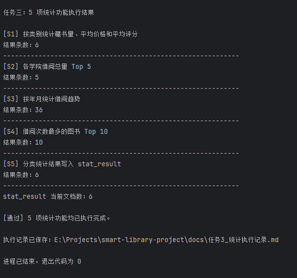

图 3-8 五项统计功能执行结果

## 3.5 索引设计与执行计划对比

任务三按照任务二索引规划完成业务索引落地。索引脚本先记录无业务索引状态下的 `executionStats`，随后创建全部规划索引，并用完全相同的查询再次采集执行计划。现有已验收环境不需要重复运行该实验。

| 集合 | 索引名称 | 键模式 | 主要用途 |
|---|---|---|---|
| `books` | `uq_books_isbn` | `{isbn: 1}` | ISBN 唯一约束 |
| `books` | `ix_books_category_price` | `{category: 1, price: 1}` | 类别与价格组合检索 |
| `books` | `ix_books_tags` | `{tags: 1}` | 标签多键检索 |
| `books` | `ix_books_publish_date` | `{publish_date: 1}` | 出版日期范围检索 |
| `books` | `ix_books_rating_desc` | `{rating: -1}` | 评分降序查询 |
| `readers` | `uq_readers_card_no` | `{card_no: 1}` | 借阅证号唯一约束 |
| `borrow_logs` | `ix_borrow_reader_date` | `{reader_card: 1, borrow_date: -1}` | 读者借阅历史与倒序查询 |
| `borrow_logs` | `ix_borrow_book` | `{book_isbn: 1}` | 图书借阅关联统计 |
| `borrow_logs` | `ix_borrow_date` | `{borrow_date: 1}` | 借阅时间范围与趋势统计 |
| `audit_logs` | `ix_audit_operate_time_desc` | `{operate_time: -1}` | 审计日志时间倒序查询 |

| 查询 | 建索引前阶段 | 建索引后阶段 | DocsExamined | KeysExamined | nReturned | 耗时 |
|---|---|---|---:|---:|---:|---:|
| `books(category, price)` | `COLLSCAN` | `IXSCAN` | 50 → 8 | 0 → 8 | 8 → 8 | 0 → 0 ms |
| `borrow_logs(reader_card, borrow_date)` | `COLLSCAN + SORT` | `IXSCAN`，无独立排序 | 3000 → 20 | 0 → 20 | 20 → 20 | 0 → 0 ms |

由于教学数据规模较小，毫秒级执行时间差异不明显，因此主要依据执行计划和扫描范围判断索引效果。第一组查询由全表扫描转为索引扫描，扫描文档从 50 条降至 8 条；第二组查询从扫描 3000 条并单独排序，转为扫描 20 条文档和 20 个索引键，且复合索引已提供目标排序。

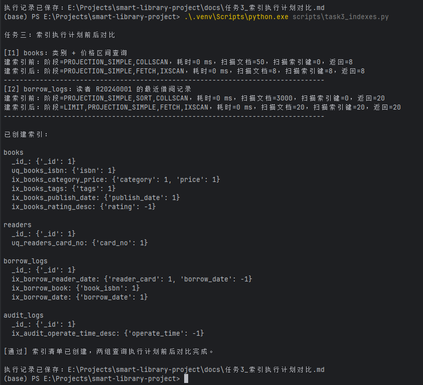

图 3-9 索引清单与两组执行计划对比

## 3.6 用户与权限管理

任务三在 `smart_library` 数据库中配置三类账号，并在专用实例中启用 `security.authorization: enabled`。账号密码仅保存在被 Git 忽略的本地 `config/.env` 中，阶段文档、示例配置和截图均不展示真实密码。

| 账号 | 角色 | 查询 | 写入 | 管理操作 |
|---|---|---|---|---|
| `libReader` | `read@smart_library` | 成功，查询 `books` 50 条 | 拒绝 | 不允许 |
| `libWriter` | `readWrite@smart_library` | 允许 | 写入并删除测试记录成功 | 不作为管理账号使用 |
| `libAdmin` | `dbOwner@smart_library` | 允许 | 允许 | 创建并删除临时索引成功 |

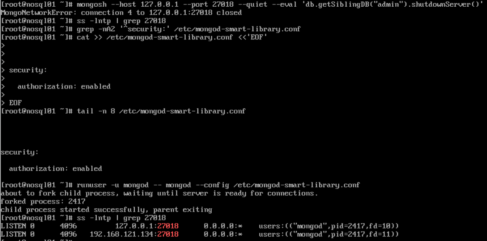

图 3-10 MongoDB 访问控制启用与实例重启

| 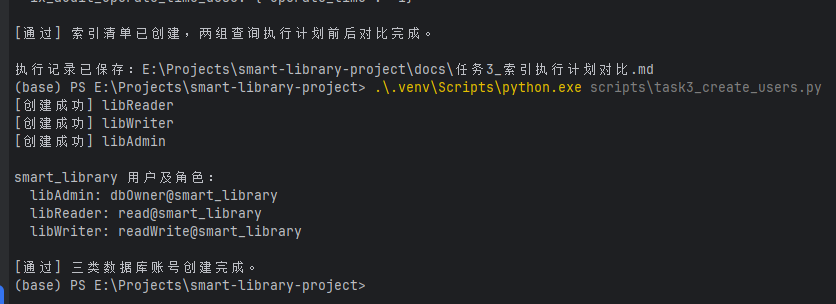 | 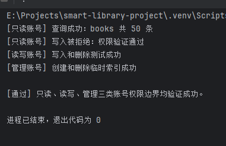 |
|:---:|:---:|
| (a) 三类数据库账号创建及角色配置 | (b) 只读 读写和管理权限边界验证 |

图 3-11 三类账号配置与权限边界验证

## 3.7 技术问题与处理

**现象：** CentOS 内部专用实例运行正常，本地 `ping` 成功，但 Windows 端 MongoDB Compass 无法连接 `27018`。

**排查：** 首先检查 MongoDB 监听地址，确认专用实例已经监听虚拟机 IP；继续检查 firewalld 开放端口，发现仅放行默认端口 `27017`。

**原因：** Linux 防火墙未开放专用实例使用的 `27018/tcp`，远程连接请求无法到达 MongoDB 服务。

**解决：** 永久放行 `27018/tcp`，重新加载 firewalld 配置并复查端口列表。

**结果：** Windows Compass 与 Python 均可通过 `27018` 正常访问专用实例，后续初始化、导入和实验脚本顺利执行。

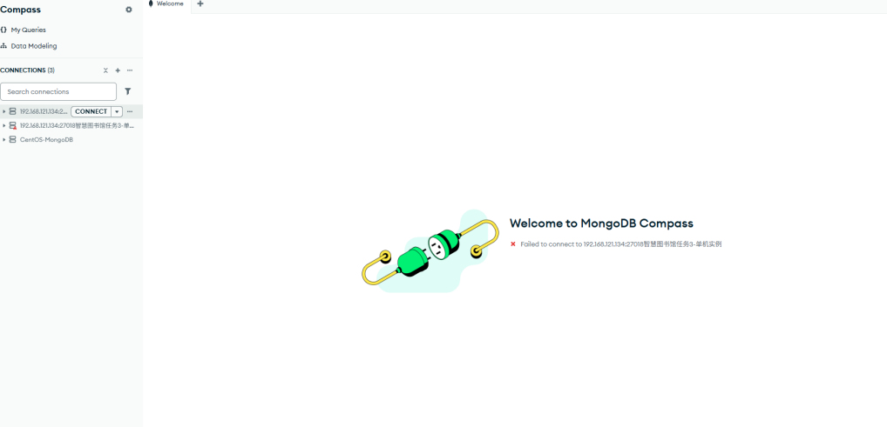

图 3-12 Windows Compass 首次连接 27018 失败

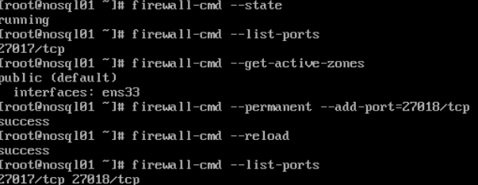

图 3-13 firewalld 永久放行 27018 端口

## 3.8 阶段结论

任务三已经完成独立单机环境、五个集合初始化、三份基础数据导入、六类检索、五项统计、索引优化及三类角色权限控制，任务书要求的四类核心证据均已归档。现有数据库与脚本为任务四 Python 应用开发以及成员 B 后续副本集部署提供了稳定基础；本阶段未启动或修改 GridFS、副本集、分片集群及任务四业务模块。
